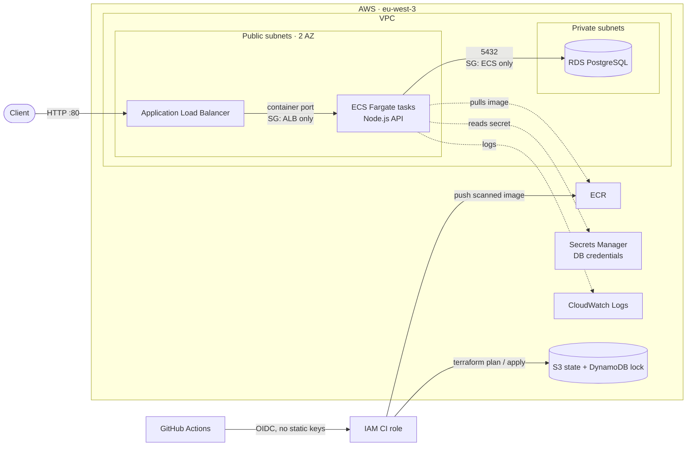

# TaskFlow

[](https://github.com/thomaspeyr31/taskflow/actions/workflows/pipeline.yml)

🇬🇧 [English version](README.md)

Une petite API REST de gestion de tâches, prétexte pour démontrer un **déploiement AWS propre et reproductible, en Infrastructure as Code avec CI/CD**.

L'application est volontairement minimale (un CRUD de tâches). L'intérêt du projet est tout ce qui l'entoure : la conteneurisation, un Terraform découpé en modules sur AWS (VPC → RDS → ECS Fargate derrière un ALB), un état distant, et un pipeline GitHub Actions qui teste, scanne, construit, planifie et déploie.

---

## Architecture



Les security groups chaînent les couches : seul l'ALB peut joindre les conteneurs, et seuls les conteneurs peuvent joindre la base. Voir [SECURITY.md](SECURITY.md) pour ce qui est volontairement simplifié dans l'environnement `dev`.

---

## Stack

| Couche | Technologie |
|--------|-------------|
| API | Node.js 20, Express |
| Base de données | PostgreSQL 16 |
| Conteneur | Docker (multi-étapes, exécution sans root) |
| Infrastructure | Terraform (modulaire) sur AWS |
| Calcul | ECS Fargate derrière un Application Load Balancer |
| État Terraform | S3 (chiffré, versionné) + verrou DynamoDB |
| CI/CD | GitHub Actions (OIDC → AWS, aucune clé statique) |
| Sécurité | npm audit, Checkov (IaC), Gitleaks (secrets), Trivy (image), Dependabot |

---

## API

| Méthode | Route | Description |
|---------|-------|-------------|
| `GET` | `/health` | Vérification de vie → `{ "status": "ok" }` |
| `GET` | `/tasks` | Lister les tâches |
| `POST` | `/tasks` | Créer une tâche — corps `{ "title": "..." }` |
| `PUT` | `/tasks/:id` | Marquer une tâche comme faite |
| `DELETE` | `/tasks/:id` | Supprimer une tâche |

Format d'une tâche : `{ id, title, done, created_at }`. Le schéma est créé automatiquement au démarrage (`initSchema` dans `src/db.js`).

---

## Lancement en local

### Avec Docker Compose (recommandé)

Démarre l'API et une base Postgres ensemble :

```bash
docker compose up --build
```

API disponible sur <http://localhost:3000>. Postgres est exposé sur le port `5433` de l'hôte.

```bash
curl http://localhost:3000/health
curl -X POST http://localhost:3000/tasks -H 'Content-Type: application/json' -d '{"title":"première tâche"}'
curl http://localhost:3000/tasks
```

### Sans Docker

Nécessite un PostgreSQL local :

```bash
cp .env.example .env       # adapter les DB_* si besoin
npm ci
npm run dev                # node --watch
```

---

## Tests

```bash
npm test
```

Lance le test runner intégré de Node (`src/__tests__/`) sur une vraie base Postgres. En CI, un conteneur Postgres de service est démarré pour cette étape.

---

## Configuration

Variables d'environnement (voir `.env.example`) :

| Variable | Défaut | Description |
|----------|--------|-------------|
| `PORT` | `3000` | Port d'écoute de l'API |
| `DB_HOST` | `localhost` | Hôte Postgres |
| `DB_PORT` | `5432` | Port Postgres |
| `DB_USER` | `taskflow` | Utilisateur Postgres |
| `DB_PASSWORD` | `taskflow` | Mot de passe Postgres |
| `DB_NAME` | `taskflow` | Nom de la base |

---

## Infrastructure (AWS / Terraform)

```
infra/
├── bootstrap/        # une seule fois : backend d'état distant S3 + DynamoDB
├── bootstrap-ci/     # une seule fois : rôle OIDC GitHub + ECR (prérequis CI)
├── modules/
│   ├── network/      # VPC, subnets publics/privés, security groups
│   ├── database/     # RDS Postgres + identifiants dans Secrets Manager
│   └── compute/      # ECR, cluster/service ECS Fargate, ALB
└── environments/
    └── dev/          # assemble les modules pour l'environnement de dev
```

### Première mise en place

Terraform ne peut pas gérer le backend qui stocke son propre état : il est donc créé à part, **une fois par compte AWS** :

```bash
export AWS_REGION=eu-west-3
cd infra/bootstrap     && ./create-backend.sh   # bucket S3 d'état + verrou DynamoDB
cd ../bootstrap-ci     && terraform init && terraform apply   # rôle OIDC + ECR
```

Détails dans [`infra/bootstrap/README.md`](infra/bootstrap/README.md) et [`infra/bootstrap-ci/README.md`](infra/bootstrap-ci/README.md).

### Déployer l'environnement de dev

```bash
cd infra/environments/dev
terraform init
terraform plan  -var "container_image=<ecr-repo>:<tag>"
terraform apply -var "container_image=<ecr-repo>:<tag>"
```

Sorties utiles : `alb_dns_name` (URL publique de l'API), `ecr_repository_url`, `ecs_cluster_name`, `ecs_service_name`.

---

## Pipeline CI/CD

`.github/workflows/pipeline.yml` s'exécute à chaque push ou PR sur `main` et s'authentifie auprès d'AWS via **OIDC** (aucun identifiant longue durée) :

1. **test** — audite les dépendances de production (`npm audit`), puis lance les tests de l'API sur un conteneur Postgres de service.
2. **security-iac** — scanne le code Terraform avec Checkov. Le rapport complet est publié dans l'onglet Security ; le job échoue sur toute anomalie absente de la baseline validée (voir [SECURITY.md](SECURITY.md)).
3. **security-secrets** — scanne tout l'historique git avec Gitleaks ; une clé, un jeton ou un mot de passe commité fait échouer le pipeline.
4. **build** — construit l'image Docker, la scanne avec Trivy (échec sur une vulnérabilité HIGH/CRITICAL corrigeable), puis pousse l'image vérifiée sur ECR (taguée avec le SHA du commit + `latest`). Ne s'exécute que si tous les jobs précédents réussissent.
5. **plan** — *sur les pull requests* : `terraform plan` publié en commentaire de la PR.
6. **deploy** — *sur push vers `main`* : `terraform apply` avec la nouvelle image, puis nouveau déploiement ECS forcé et attente de la stabilisation du service.

Dependabot propose chaque semaine les mises à jour des paquets npm, de l'image Docker de base et des GitHub Actions.

Les risques volontairement acceptés dans l'environnement `dev` (HTTP sans TLS, tâches en subnet public, clés gérées par AWS…) et leur correction en production sont détaillés dans [SECURITY.md](SECURITY.md).

### Réglages GitHub nécessaires

| Type | Nom | Rôle |
|------|-----|------|
| Variable | `AWS_ROLE_ARN` | Rôle IAM assumé via OIDC (créé par `bootstrap-ci`) |
| Environnement | `dev` | Contrôle le job de déploiement |

---

## Organisation du dépôt

```
taskflow/
├── src/                 # API Express
│   ├── index.js         # point d'entrée (schéma + écoute)
│   ├── app.js           # fabrique de l'app, routes, gestion d'erreurs
│   ├── db.js            # pool pg + création du schéma
│   ├── routes/tasks.js  # routes CRUD
│   └── __tests__/       # tests de l'API
├── infra/               # Terraform (voir plus haut)
├── .github/             # pipeline CI/CD + Dependabot
├── Dockerfile           # multi-étapes, sans root
├── docker-compose.yml   # API + Postgres en local
└── .env.example
```
