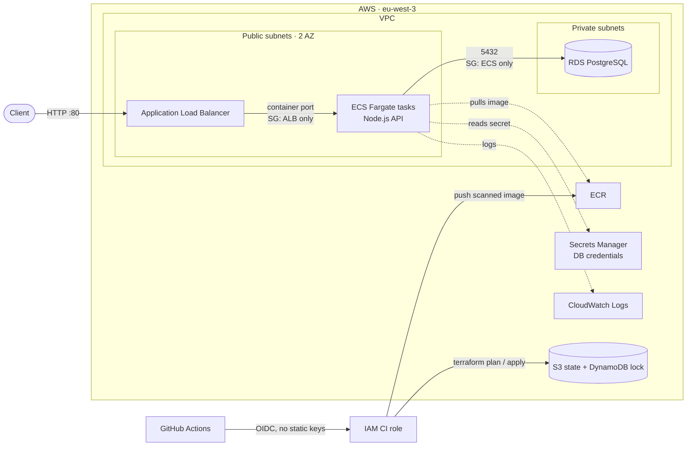

# TaskFlow

[](https://github.com/thomaspeyr31/taskflow/actions/workflows/pipeline.yml)

A small task-management REST API used as a vehicle to demonstrate a clean,
reproducible and **secure AWS deployment with Infrastructure-as-Code and CI/CD**.

The application itself is deliberately minimal (a CRUD over tasks). The point of
the project is everything around it: containerization, a modular Terraform setup
on AWS (VPC → RDS → ECS/Fargate behind an ALB), remote state, and a GitHub
Actions pipeline that tests, scans, builds, plans and deploys.

---

## Architecture



Security groups chain the tiers: only the ALB can reach the containers, and only
the containers can reach the database. See [SECURITY.md](SECURITY.md) for what
is deliberately simplified in this `dev` environment.

---

## Stack

| Layer | Tech |
|-------|------|
| API | Node.js 20, Express |
| Database | PostgreSQL 16 |
| Container | Docker (multi-stage, non-root runtime) |
| Infrastructure | Terraform (modular) on AWS |
| Compute | ECS Fargate behind an Application Load Balancer |
| State | S3 (encrypted, versioned) + DynamoDB lock |
| CI/CD | GitHub Actions (OIDC → AWS, no static keys) |
| Security | npm audit, Checkov (IaC), Trivy (image), Dependabot |

---

## API

| Method | Route | Description |
|--------|-------|-------------|
| `GET` | `/health` | Liveness check → `{ "status": "ok" }` |
| `GET` | `/tasks` | List all tasks |
| `POST` | `/tasks` | Create a task — body `{ "title": "..." }` |
| `PUT` | `/tasks/:id` | Mark a task as done |
| `DELETE` | `/tasks/:id` | Delete a task |

Task shape: `{ id, title, done, created_at }`. The schema is created
automatically on startup (`initSchema` in `src/db.js`).

---

## Run locally

### With Docker Compose (recommended)

Starts the API and a Postgres database together:

```bash
docker compose up --build
```

API available on <http://localhost:3000>. Postgres is exposed on host port `5433`.

```bash
curl http://localhost:3000/health
curl -X POST http://localhost:3000/tasks -H 'Content-Type: application/json' -d '{"title":"first task"}'
curl http://localhost:3000/tasks
```

### Without Docker

Requires a local PostgreSQL. Copy the env template and run:

```bash
cp .env.example .env       # adjust DB_* if needed
npm ci
npm run dev                # node --watch
```

---

## Tests

```bash
npm test
```

Runs the Node built-in test runner (`src/__tests__/`) against a real Postgres.
In CI, a Postgres service container is spun up for this step.

---

## Configuration

Environment variables (see `.env.example`):

| Variable | Default | Description |
|----------|---------|-------------|
| `PORT` | `3000` | API listen port |
| `DB_HOST` | `localhost` | Postgres host |
| `DB_PORT` | `5432` | Postgres port |
| `DB_USER` | `taskflow` | Postgres user |
| `DB_PASSWORD` | `taskflow` | Postgres password |
| `DB_NAME` | `taskflow` | Database name |

---

## Infrastructure (AWS / Terraform)

```
infra/
├── bootstrap/        # one-shot: create the S3 + DynamoDB remote-state backend
├── bootstrap-ci/     # one-shot: GitHub OIDC role + ECR (CI prerequisites)
├── modules/
│   ├── network/      # VPC, public/private subnets, security groups
│   ├── database/     # RDS Postgres + credentials in Secrets Manager
│   └── compute/      # ECR, ECS Fargate cluster/service, ALB
└── environments/
    └── dev/          # wires the modules together for the dev environment
```

### First-time setup

Terraform cannot manage the backend that stores its own state, so it is created
out-of-band, **once per AWS account**:

```bash
export AWS_REGION=eu-west-3
cd infra/bootstrap     && ./create-backend.sh   # S3 state bucket + DynamoDB lock
cd ../bootstrap-ci     && terraform init && terraform apply   # OIDC role + ECR
```

See [`infra/bootstrap/README.md`](infra/bootstrap/README.md) and
[`infra/bootstrap-ci/README.md`](infra/bootstrap-ci/README.md) for details.

### Deploy the dev environment

```bash
cd infra/environments/dev
terraform init
terraform plan  -var "container_image=<ecr-repo>:<tag>"
terraform apply -var "container_image=<ecr-repo>:<tag>"
```

Useful outputs: `alb_dns_name` (public API URL), `ecr_repository_url`,
`ecs_cluster_name`, `ecs_service_name`.

---

## CI/CD pipeline

`.github/workflows/pipeline.yml` runs on every push/PR to `main` and
authenticates to AWS via **OIDC** (no long-lived credentials):

1. **test** — audit production dependencies (`npm audit`), then run the API
   test suite against a Postgres service container.
2. **security-iac** — scan the Terraform code with Checkov. The full report is
   published to the Security tab; the job fails on any finding that is not in
   the reviewed baseline (see [SECURITY.md](SECURITY.md)).
3. **build** — build the Docker image, scan it with Trivy (fails on fixable
   HIGH/CRITICAL vulnerabilities), then push the scanned image to ECR (tagged
   with the commit SHA + `latest`). Runs only if both previous jobs pass.
4. **plan** — *on pull requests*: `terraform plan` posted back as a PR comment.
5. **deploy** — *on push to `main`*: `terraform apply` with the new image, then
   force a new ECS rollout and wait for the service to stabilize.

Dependabot proposes weekly updates for npm packages, the Docker base image and
GitHub Actions.

### Required GitHub settings

| Kind | Name | Purpose |
|------|------|---------|
| Variable | `AWS_ROLE_ARN` | IAM role assumed via OIDC (from `bootstrap-ci`) |
| Environment | `dev` | Gates the deploy job |

---

## Project layout

```
taskflow/
├── src/                 # Express API
│   ├── index.js         # entrypoint (init schema + listen)
│   ├── app.js           # app factory, routes, error handler
│   ├── db.js            # pg pool + schema bootstrap
│   ├── routes/tasks.js  # CRUD routes
│   └── __tests__/       # API tests
├── infra/               # Terraform (see above)
├── .github/             # CI/CD pipeline + Dependabot
├── Dockerfile           # multi-stage, non-root
├── docker-compose.yml   # local API + Postgres
├── SECURITY.md          # security controls and accepted risks
└── .env.example
```
